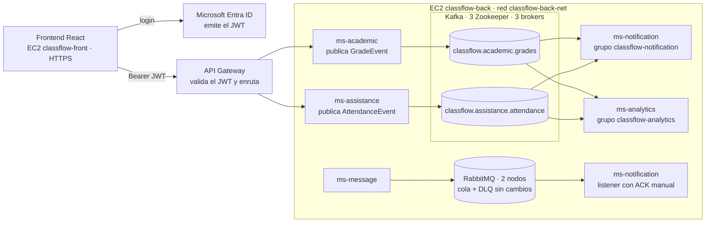

# Informe técnico EP3: streaming de eventos con Apache Kafka en ClassFlow

**Asignatura:** DSY1107 Desarrollo Cloud Native I · **Evaluación:** Parcial 3
**Integrante:** Evens Reneus · **Docente:** [Nombre del docente] · **Fecha:** noviembre 2026

**Material complementario:** informe y presentación en Canva — ver [Entregables](#13-entregables-y-repositorios).

---

## 1. Resumen ejecutivo

ClassFlow procesa en streaming los eventos de notas y asistencia con Apache Kafka. La plataforma corre en AWS EC2 con 3 nodos Zookeeper, 3 brokers y Kafka UI, levantados con Docker Compose.

- **Productores:** `ms-academic` y `ms-assistance` publican un evento por cada nota o asistencia registrada, con clave y JSON, sin bloquear la respuesta al usuario.
- **Consumidores:** dos consumer groups independientes leen los mismos eventos: `classflow-notification` avisa al estudiante y `classflow-analytics` calcula indicadores en tiempo real.
- **Reacción visible:** la vista *Reportes → En vivo* del frontend se actualiza sola cada 5 segundos.
- **Administración:** `ms-kafka-admin` gestiona tópicos, configuraciones y consumer groups; Kafka UI supervisa offsets, lag y particiones.
- **Convivencia:** el clúster RabbitMQ de 2 nodos de la EP2 sigue sin cambios en colas, exchanges y DLQ.

El código pasa 314 pruebas automatizadas en el backend y 79 en el frontend. El despliegue se verificó en EC2 el 25 de noviembre de 2026, incluido un rebalance real del consumer group de notificaciones.

## 2. Contexto y objetivos

| Etapa | Qué aportó | Estado en la EP3 |
| --- | --- | --- |
| EP1 | IDaaS (Microsoft Entra ID), frontend con OAuth 2.0 / OIDC, API Gateway que valida el JWT, microservicios | Se mantiene |
| EP2 | Clúster RabbitMQ de 2 nodos con colas, exchanges y DLQ | Se mantiene sin cambios |
| EP3 | Kafka: 3 Zookeeper, 3 brokers, Kafka UI, 2 tópicos de 3 particiones y 3 réplicas, consumer groups y analítica | Nuevo |

**Objetivos:**

1. Desplegar en la nube un clúster Kafka tolerante a fallos y administrable.
2. Publicar eventos de dominio desde los microservicios que registran notas y asistencia.
3. Consumir esos eventos con grupos de propósito distinto que reaccionen en tiempo real.
4. Administrar tópicos, retención y consumer groups, y supervisar offsets y lag.
5. Demostrar que RabbitMQ sigue funcionando igual que en la EP2.

## 3. Arquitectura

| Repositorio | Contenido |
| --- | --- |
| [ClassFlowBack](https://github.com/Ereneus/ClassFlowBack) | API Gateway, BFF y microservicios Spring Boot |
| [ClassFlowFront](https://github.com/Ereneus/ClassFlowFront) | Frontend React + Vite con MSAL |
| [ClassFlowKafka](https://github.com/Ereneus/ClassFlowKafka) | 3 Zookeeper, 3 brokers, script de tópicos y Kafka UI |
| [ClassFlowRabbitMQ](https://github.com/Ereneus/ClassFlowRabbitMQ) | Clúster RabbitMQ de 2 nodos |

## 4. Plataforma Kafka (IL 3.1)

| Componente | Imagen | Rol |
| --- | --- | --- |
| `zookeeper-1..3` | `confluentinc/cp-zookeeper:7.7.1` | Ensemble que guarda los metadatos y elige al controller. Quorum de 2 de 3. |
| `kafka-1..3` | `confluentinc/cp-kafka:7.7.1` | Log particionado; cada partición tiene un líder y dos réplicas. |
| `kafka-init` | `confluentinc/cp-kafka:7.7.1` | Crea los tópicos con `kafka/create-topics.sh` (idempotente). |
| `kafka-ui` | `provectuslabs/kafka-ui:v0.7.2` | Consola web con login: brokers, tópicos, mensajes, grupos, offsets y lag. |

**Durabilidad:** factor de replicación 3 en todos los tópicos, incluido `__consumer_offsets`; `min.insync.replicas=2` con `acks=all`; creación automática de tópicos desactivada; cada Zookeeper se marca sano solo cuando está en el quorum.

| Tópico | Clave | Política | Caso de uso |
| --- | --- | --- | --- |
| `classflow.academic.grades` | `gradeId` | `compact,delete`, 180 días | Estado de las notas: conserva la última versión de cada una. |
| `classflow.assistance.attendance` | `studentId` | `delete`, 30 días o 1 GiB | Bitácora de alto volumen, en orden por estudiante. |
| `*.DLT` | la del mensaje original | `delete`, 14 días | Mensajes con error para analizar o reprocesar. |

**3 particiones:** hasta 3 consumidores en paralelo por grupo y un líder por broker. **3 réplicas:** el máximo con 3 brokers; con `min.insync.replicas=2` soporta perder un broker.

## 5. Diseño de los eventos

Clases propias (`record`) serializadas como JSON plano, sin tipos de Java en los headers. Cada consumidor valida su copia con Bean Validation.

| GradeEvent | Tipo | Uso |
| --- | --- | --- |
| `eventId` | UUID | Trazabilidad en logs |
| `eventType` | `GRADE_CREATED` / `GRADE_UPDATED` / `GRADE_DELETED` | Qué pasó con la nota |
| `gradeId` | Long | Clave: orden por nota |
| `studentId` | Long | Destinatario y agrupación |
| `evaluationId`, `evaluationName`, `subjectId` | Long, String, Long | Contexto sin consultar `ms-academic` |
| `score`, `maxScore` | Double | Nota y porcentaje de logro |
| `occurredAt` | Instant | Descarta eventos antiguos al releer |

| AttendanceEvent | Tipo | Uso |
| --- | --- | --- |
| `eventId` | UUID | Trazabilidad |
| `eventType` | `ATTENDANCE_REGISTERED` / `ATTENDANCE_UPDATED` | Registro o corrección |
| `attendanceId` | Long | La corrección reemplaza al registro anterior |
| `studentId` | Long | Clave: orden por estudiante |
| `courseId`, `date` | Long, LocalDate | Asistencia por curso y día |
| `present`, `justification` | Boolean, String | Ausencias justificadas o no |
| `occurredAt` | Instant | Orden y descarte |

## 6. Productores, consumidores y errores (IL 3.2)

- **Productores** (`GradeEventProducer`, `AttendanceEventProducer`): `KafkaTemplate`, `JsonSerializer`, `acks=all`, idempotencia, `lz4`, `linger.ms=10`, `max.block.ms=5000`. Publicación asíncrona: un fallo de Kafka queda en el log sin romper la operación HTTP.
- **Consumidores** (`AcademicEventsKafkaListener`, `AnalyticsKafkaListener`): `@KafkaListener`, validan el payload y delegan en `AcademicEventNotificationService` / `AcademicAnalyticsService`. Offset confirmado tras procesar.
- **Errores:**
  1. `ErrorHandlingDeserializer` aísla un JSON corrupto.
  2. Bean Validation rechaza payloads incompletos.
  3. `DefaultErrorHandler` reintenta con backoff exponencial (1 s, 2 s, 4 s).
  4. `DeadLetterPublishingRecoverer` envía el mensaje a `<tópico>.DLT` con la causa en headers.
- **Tiempo real:** la vista *En vivo* consulta `/api/analytics/summary` cada 5 s (`VITE_ANALYTICS_REFRESH_MS`).

## 7. Administración (IL 3.3)

| Grupo | Servicio | Confirmación | Propósito |
| --- | --- | --- | --- |
| `classflow-notification` | `ms-notification` | Por registro | Avisos; persiste en BD, escala con instancias |
| `classflow-analytics` | `ms-analytics` | Por lote | Indicadores en memoria; relee los tópicos al arrancar |

Ambos con concurrencia 3, `CooperativeStickyAssignor` y `read_committed`.

**Rebalance verificado en EC2:** con `docker compose up -d --scale ms-notification=2` el grupo queda con 6 consumidores para 3 particiones por tópico. Al detener la instancia activa, la otra tomó las 6 particiones (columna `HOST` en `kafka-consumer-groups --describe`).

**`ms-kafka-admin`** (`/api/kafka/**`, rol administrador): ver clúster; listar, describir, crear y eliminar tópicos (los de ClassFlow protegidos); modificar configuraciones; aumentar particiones; listar grupos con lag; reiniciar offsets y eliminar grupos.

## 8. Convivencia con RabbitMQ

| Aspecto | RabbitMQ (EP2) | Kafka (EP3) |
| --- | --- | --- |
| Uso en ClassFlow | Mensajes entre usuarios, con DLQ | Notas y asistencia, analítica |
| Modelo | Cola: se borra tras el ACK | Log: se retiene y se relee |
| Consumidores | Compiten por la cola | Cada grupo recibe todo |
| Orden | Por cola | Por partición, según la clave |

Colas, exchanges y DLQ de la EP2 sin cambios; `ms-message` mantiene `/api/rabbitmq/**`.

## 9. Despliegue en AWS EC2

| Instancia | Tipo | Contenido |
| --- | --- | --- |
| `classflow-back` | t3.large (8 GiB + 4 GiB swap) | Kafka (8 contenedores), RabbitMQ (2), backend (17), Caddy HTTPS |
| `classflow-front` | t3.medium | Frontend React (Nginx), Caddy HTTPS |

Orden de arranque: `docker network create classflow-back-net` → ClassFlowKafka → ClassFlowRabbitMQ → ClassFlowBack → frontend.

## 10. Pruebas y resultados

| Prueba | Evidencia | Estado |
| --- | --- | --- |
| Sin token | `curl` a `/api/analytics/summary` → 401 | Verificado en EC2 |
| Estado de la plataforma | 6 nodos `healthy`, `kafka-init` con código 0 | Verificado en EC2 |
| Dos grupos sobre el mismo tópico | `kafka-consumer-groups --describe` con offsets propios | Verificado en EC2 |
| Rebalance | La segunda instancia tomó las 6 particiones | Verificado en EC2 |
| Convivencia con RabbitMQ | `cluster_status` con 2 nodos, `ms-notification` conectado | Verificado en EC2 |
| Consumo normal y misma clave | Pruebas con Kafka embebido y del productor | Pruebas automatizadas |
| Evento inválido | JSON corrupto y evento sin `studentId` llegan a `.DLT` | Pruebas automatizadas |
| Reacción en tiempo real | Prueba del componente En vivo | Pruebas automatizadas |
| Token válido, caída de broker, retención | Login, `docker compose stop kafka-2`, Kafka UI Settings | Por demostrar en vivo |

## 11. Limitaciones y mejoras

| Limitación | Mejora propuesta |
| --- | --- |
| `ms-analytics` guarda estado en memoria | Persistir en PostgreSQL/Redis o Kafka Streams |
| Todo el backend en un t3.large | Separar la mensajería o usar Amazon MSK / Amazon MQ |
| Zookeeper | Migrar a KRaft |
| Colas clásicas en RabbitMQ | Quorum queues (no aplicado: la guía pide no modificar la EP2) |
| Kafka sin TLS ni autenticación | SASL/SCRAM y TLS si se expone fuera de la instancia |
| Refresco por consulta periódica | Server-Sent Events o WebSocket |

## 12. Conclusiones

Kafka permite publicar una vez un evento de nota o asistencia y que notificaciones y analítica lo procesen a su ritmo, con la posibilidad de releerlo. El clúster tolera la caída de un nodo de cada tipo, los consumer groups se recuperan solos y RabbitMQ y Kafka conviven con roles claros.

## 13. Entregables y repositorios

- Informe en Canva: [Informe técnico EP3 de ClassFlow](https://www.canva.com/d/RghIYlBti5su4Sv)
- Presentación en Canva: [Evaluación ClassFlow](https://www.canva.com/d/wiPYoqabVZMu88B)
- Repositorios: [ClassFlowBack](https://github.com/Ereneus/ClassFlowBack) · [ClassFlowFront](https://github.com/Ereneus/ClassFlowFront) · [ClassFlowKafka](https://github.com/Ereneus/ClassFlowKafka) · [ClassFlowRabbitMQ](https://github.com/Ereneus/ClassFlowRabbitMQ)
